# API Store

An e-commerce backend with REST and GraphQL APIs, built as a modular monolith in Scala. It is a practice project to get comfortable with a production-style Scala stack.

Scala 2.13, Play 3.0, MySQL 8.4, Relate, Flyway, play-json, Sangria, JDK 17, sbt.

## Features

- Authentication: sign up, sign in, sign out, change password, and password reset by email. Passwords are hashed, access tokens are short-lived JWTs, and refresh tokens are rotated. Sign-in and password reset are rate limited.
- Roles: clients and managers, with a 403 for anything outside the role.
- Public catalog: product list with pagination, sorting and a category filter, plus product detail. No sign-in needed.
- Manager tools: create, disable, enable and delete products. A product with open orders can't be deleted.
- Cart and checkout: a cart per client, and checkout in one transaction that decreases stock atomically and applies discounts.
- Orders: clients see their own orders and tracking, and managers list all orders and update the delivery status through valid transitions only.
- Email notifications: welcome, password changes and resets, and order status updates. They are sent in the background, and a failed email never breaks a request.
- API documentation: Swagger UI for both REST and GraphQL.

## Roadmap

Stripe payments, product images, product update with price history, liked products with low-stock and discount alerts, and order filters for managers.

## Requirements

- JDK 17
- sbt (the version is pinned in `project/build.properties`)
- Docker with Docker Compose, for MySQL and the Mailpit mail catcher
- `openssl`, to generate two secrets
- A Unix shell (macOS or Linux) for the `./dev.sh` script. On Windows, use WSL.

The app uses ports 9000 (API), 3306 (MySQL), 1025 and 8025 (Mailpit), so these must be free.

## Setup

1. Copy the example settings and fill in the secrets:

   ```
   cp .env.example .env
   ```

   Generate the two keys and paste them into `.env`:

   ```
   openssl rand -base64 48    # JWT_SECRET
   openssl rand -base64 32    # ENCRYPTION_KEY
   ```

   Also choose a value for `MYSQL_ROOT_PASSWORD` and `MYSQL_PASSWORD`. Everything else in the example file already has a working local value.

2. Start MySQL and Mailpit:

   ```
   docker compose up -d
   ```

   Wait until MySQL reports healthy (`docker compose ps`).

3. Run the app:

   ```
   ./dev.sh run
   ```

   The API is at http://localhost:9000. The database tables are created automatically at startup. Check it with:

   ```
   curl http://localhost:9000/health
   ```

   The first request may take a while, because Play compiles and starts the app in development mode.

Emails sent by the app appear in Mailpit at http://localhost:8025.

### Environment variables

| Variable | Required | Meaning |
| --- | --- | --- |
| `MYSQL_HOST`, `MYSQL_PORT`, `MYSQL_DATABASE`, `MYSQL_USER`, `MYSQL_PASSWORD` | yes | Database connection. `MYSQL_ROOT_PASSWORD` is used only by the Docker container. |
| `DB_POOL_SIZE` | no | Size of the connection pool (default 10). |
| `MAIL_HOST`, `MAIL_PORT`, `MAIL_USER`, `MAIL_PASSWORD`, `MAIL_FROM` | yes | SMTP server. In development Mailpit needs no login, so user and password stay empty. |
| `FRONTEND_BASE_URL` | yes | Address used for links in emails. |
| `JWT_SECRET` | yes | Signing key for access tokens, at least 32 bytes. |
| `JWT_ACCESS_TOKEN_TTL`, `JWT_REFRESH_TOKEN_TTL` | no | Token lifetimes (defaults: 15 minutes and 30 days). |
| `ENCRYPTION_KEY` | yes | AES-256 key, 32 random bytes in Base64, that encrypts secrets stored in the database. |
| `GRAPHQL_MAX_DEPTH`, `GRAPHQL_MAX_COMPLEXITY` | no | GraphQL query limits (defaults: 15 and 300). |
| `CORS_ALLOWED_ORIGINS` | no | Comma-separated browser origins allowed to call the API. Empty means none. |

## API documentation

With the app running, open the Swagger UI at http://localhost:9000/assets/docs/index.html. The OpenAPI spec is at http://localhost:9000/assets/swagger.json. It documents every REST route and the GraphQL endpoint.

To call protected routes from the page:

1. Run `POST /auth/sign-up` to create an account, then `POST /auth/sign-in`.
2. Copy the `access_token` from the sign-in response.
3. Click **Authorize**, paste the token, and confirm. The padlocks close, and protected routes now send it.

Access tokens last 15 minutes. If you get a 401, sign in again.

GraphQL is a single endpoint, `POST /graphql`, and every operation needs a token. Its description lists all the GraphQL operations, and the **Examples** dropdown fills in a ready-to-run query or mutation for each one. Replace ids such as `ORDER_ID` with real values from earlier responses.

Manager operations (creating, disabling and deleting products, shipping orders) need a user with the manager role. There is no seeded manager yet, so promote a signed-up user in the database:

```sql
UPDATE identity_user SET role = 'MANAGER' WHERE email = 'you@example.com';
```

Then sign in again, because the old token still carries the client role.

## Try it: the demo page

The `demo/` folder holds a single-page demo that shows the whole shopping flow with a client and a manager side by side. It is for local use only.

1. In `.env`, set `CORS_ALLOWED_ORIGINS=http://localhost:8000` and restart the app. The API only accepts browser calls from origins in that list.
2. Serve the page (do not open the file directly, because the browser would then send an origin the API rejects):

   ```
   python3 -m http.server 8000 --directory demo
   ```

   Open http://localhost:8000.

3. Reset the demo data. Run `demo/reset.sql` in any MySQL client, or from the terminal:

   ```
   set -a; source .env; set +a
   docker exec -i api-store-mysql mysql -u"$MYSQL_USER" -p"$MYSQL_PASSWORD" "$MYSQL_DATABASE" < demo/reset.sql
   ```

   This **deletes every account, cart and order** and leaves five products. Never run it against a real database.

4. On the page, press **1. Sign up** in the Client panel and in the Manager panel (the accounts are pre-filled: `demo-client@apistore.com` and `demo-manager@apistore.com`, and so is the password). Then promote the manager in the database:

   ```sql
   UPDATE identity_user SET role = 'MANAGER' WHERE email = 'demo-manager@apistore.com';
   ```

   Press **2. Sign in** in both panels, and press **Refresh** above the product table.

A short walkthrough:

1. Client: select a product in the table, set a quantity, **4. Add selected to cart**, **5. My cart**, **6. Checkout**.
2. Manager: **7. All orders**, select the new order, pick a delivery date, **8. Ship selected**, then **9. Deliver selected**.
3. Open Mailpit (link at the top of the page) to see the order emails. They arrive within about 30 seconds.
4. Manager: **3. Create product**, then **4. Disable selected** and **5. Enable selected**. The client's product list follows. Try **6. Delete selected** on a product that is in an open order, and the API refuses.
5. The "Failure cases" buttons show the 403, 401 and 400 responses.

## Architecture

API Store is a modular monolith: one Play application, one MySQL database, and five bounded contexts inside the code: identity, catalog, shopping, ordering and notifications. Each context has its own domain, application and infrastructure packages. A top-level `graphql` package is a thin adapter that exposes the use cases over GraphQL.



Stripe is shown as an external system because payments are planned. They are not built yet, and checkout confirms the order immediately.

The main design rules:

- Contexts call each other only through small interfaces (ports) that the other context implements. They never touch each other's classes or tables, and no table has a database foreign key to another context's table, so a context can be split out later.
- Everything that must succeed or fail together runs in one database transaction, for example checkout (order, stock and cart).
- Emails are not sent inside a request. A request writes an event to a transactional outbox, and a background poller sends the email afterwards.
- Dependencies are wired in plain Scala code (compile-time dependency injection), so there is no Spring-style container and missing wiring is a compile error.

More detail:

- [Documentation index](docs/README.md)
- [ADR 0001: architecture style and technology stack](docs/adr/0001-architecture-style-and-technology-stack.md)
- [ADR 0002: product pricing, embedded discount and price history](docs/adr/0002-product-pricing-embedded-discount-and-price-history.md)
- [ADR 0003: compile-time dependency injection](docs/adr/0003-compile-time-dependency-injection.md)
- [ADR 0004: JSON library, play-json](docs/adr/0004-json-library-play-json.md)
- [C4 level 1: system context](docs/c4/c4-level1-context.md)
- [C4 level 2: containers](docs/c4/c4-level2-containers.md)

## Tests

Run all tests with:

```
./dev.sh test
```

Docker must be running. Most integration tests start a real MySQL 8.4 container with Testcontainers and run the migrations on it, so no local database setup is needed. Some unit tests use fakes and need no database.

To run one spec:

```
./dev.sh "testOnly *SignUpUseCaseSpec"
```

To get a coverage report:

```
./dev.sh clean coverage test coverageReport
```

Open `target/scala-2.13/scoverage-report/index.html` in a browser. Run `./dev.sh clean` afterwards, so the next normal build does not keep the coverage counters.
