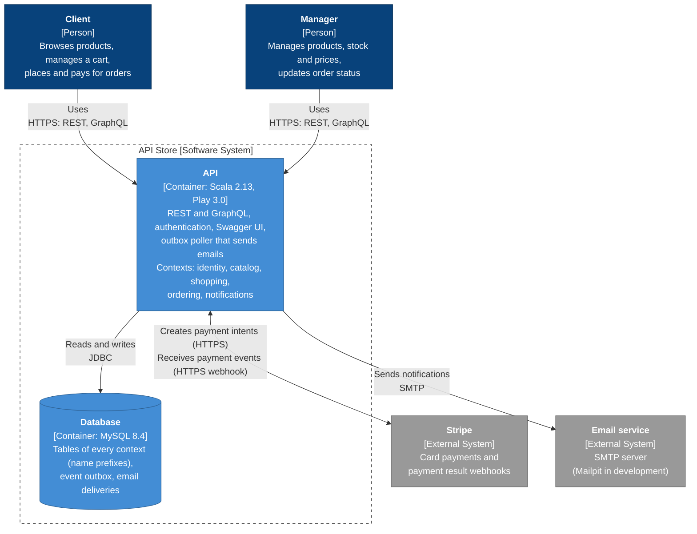

# C4 level 2: Containers

This diagram opens the API Store box from level 1. It shows what runs: the API application and its database, with the people and external systems around them. The components inside the API are not drawn here.

## Elements

| Element | Type | Description |
| --- | --- | --- |
| API | Container (Scala 2.13, Play 3.0) | One application, a modular monolith. It serves REST and GraphQL, authenticates users, serves the Swagger UI, and runs the outbox poller that sends emails. Its code is split into five contexts: identity, catalog, shopping, ordering and notifications. |
| Database | Container (MySQL 8.4) | One database shared by all contexts. Each context's tables have their own name prefix, and no table has a foreign key to another context's table. It also holds the event outbox and the email deliveries. |
| Client, Manager | Person | As in level 1. |
| Stripe | External system | Card payments and payment result webhooks. Planned in ADR 0001, not built yet. |
| Email service | External system | An SMTP server that delivers notification emails. Mailpit is used in development. |

## Notes

- The contexts are not containers. They are modules inside the API process, and each could become its own service later (ADR 0001). A component diagram (level 3) is not drawn yet.
- The API and the database are the only two runnable parts of the system. The Swagger UI is static files served by the API.
- The API talks to the database over JDBC (Relate and HikariCP). Emails are not sent inside a request: a request writes an event to the outbox in the same transaction, and the poller sends the email afterwards.
- The Stripe link is drawn as one two-way arrow: the API creates payment intents, and Stripe calls back with a signed webhook. The webhook is the only inbound call from an external system.
- The demo page used for the presentation is a development tool, not a container, so it is not drawn.
- The diagram source is the Mermaid block above (also in `c4-level2-containers.mmd`). Regenerate the SVG when it changes.
